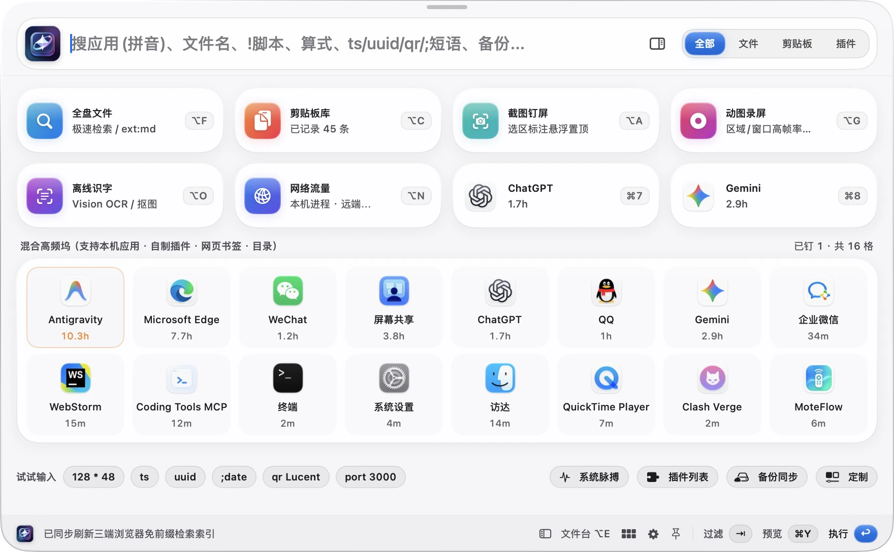
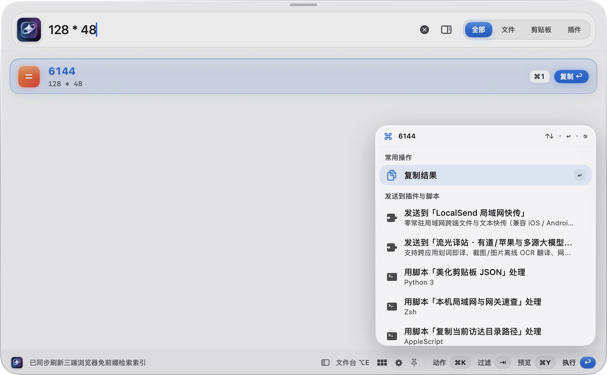
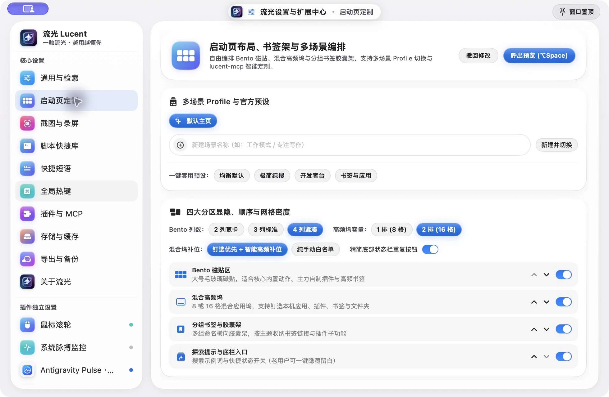

#  流光 Lucent

> **在线体验**：[3D 主页](https://lengsukq.github.io/Lucent/) ｜ [2D 详解页](https://lengsukq.github.io/Lucent/overview.html) ｜ [官方插件库](plugin-demo/README.md) ｜ [技术文档](docs/INDEX.md) ｜ [下载最新 DMG](https://github.com/lengsukq/Lucent/releases/latest)

**10 MB 免费开源纯原生 macOS 效率中枢，一个软件替掉 5 个付费工具。**

免登录、零订阅、不卖 AI 会员。按一下 `⌥Space`，搜索、截图标注与长截图、穿透贴图、录屏、离线识字、外接鼠标平滑与磁吸文件中转站一次搞定，用完自动释放内存。



## 为什么选 Lucent？

| 对比维度 | **流光 Lucent** | Raycast | uTools | Alfred + 单品 |
| --- | --- | --- | --- | --- |
| **开源与收费** | **MIT 开源 · 全免费 · 免登录** | 闭源 · Pro 订阅解锁同步 / AI | 闭源 · 需登录与会员 | 闭源 · 买断 + 另购多款 App |
| **AI / MCP** | **内置 21 MCP · 直连你的 AI** | 自家 AI Credits 订阅 | 自家 AI 会员 | 无原生 MCP |
| **系统原生利器** | **长截图 · 穿透贴图 · 录屏 · 鼠标平滑 · 磁吸托盘** | 无内置 | 依赖第三方插件 | 需另装 4–5 个软件 |
| **插件形态** | **原生页 + 透明点击穿透挂件** | 仅列表 / 表单 | Electron 独立窗 | 仅列表 / Workflow |
| **体量与内存** | **~10 MB 纯原生 · 用完即焚** | 原生 + Node 扩展 | Electron 偏重 | 多软件同时常驻 |

## 核心功能一览

- **全能搜索与动作（`⌥Space` / `⌘K`）**：免前缀秒搜软件、本机与外置硬盘文件、剪贴板历史（支持 15 步误删撤回）、算式与单位换算、快捷脚本、快捷短语及常用开发小工具；按 `⌘K` 呼出上下文动作抽屉。
- **自定义启动面板与菜单栏**：自由编排 Bento 磁贴、混合高频坞与分组书签架，支持 4 套预设与多场景切换；状态栏菜单、快捷键、晴霜浅色 / 曜石暗色双主题与中英双语均可随时切换。
- **截图、长截图、穿透贴图、录屏与识字（`⌥A` / `⌥G` / `⌥R` / `⌥O`）**：多屏原画截图标注（11 种工具 + 二次编辑）、滚动长截图拼接、钉屏按 `T` 半透明点击穿透、区域 GIF（`⌥G`）/ MP4（`⌥R`）录屏、本地离线 OCR 识字。
- **外接鼠标平滑滚轮**：只为外接鼠标开启 120Hz 平滑滚动与独立方向反转，完全保留苹果触控板原生手感。
- **按需实用工具箱（`⌥E` / `⌥M` / `⌥N`）**：双栏文件整理台（NTFS 移动硬盘只读保护）、芯片功耗监控、软件实时网速与安全清缓存、轻量 Markdown / 看图 / 4K 视频播放窗，关窗即释放内存。
- **连上你已有的 AI 十秒造工具**：内置 `lucent-mcp`，连接 Claude Code / Cursor / Codex / Gemini CLI 后，一句话写脚本、造插件、排启动面板并热重载生效。
- **透明悬浮挂件 & 跨机同步**：支持无边框透明点击穿透桌面挂件、三向磁吸边缘停靠、本地加密备份与 WebDAV（坚果云 / NAS）同步；所有悬浮挂件默认关闭，不打扰不占内存。





## 13 款官方精选插件

详细说明见 [`plugin-demo/`](plugin-demo/README.md)，在设置中粘贴仓库链接即可一键订阅安装（全原生 Swift 二进制，零 Python 依赖）：

| 插件 | 功能 |
| --- | --- |
| [`window-snap`](plugin-demo/window-snap/README.md) | **窗口分屏与工作区**：半屏/三分屏/四象限/跨屏瞬移、一键撤销与多屏工作区布局快照恢复 |
| [`file-shelf`](plugin-demo/file-shelf/README.md) | **文件中转站**：三向磁吸边缘停靠托盘，跨屏拖拽暂存与跨重启恢复 |
| [`local-send`](plugin-demo/local-send/README.md) | **局域网快传**：兼容 LocalSend v2.1 跨设备收发，开窗监听、关窗即释放端口 |
| [`audio-presets`](plugin-demo/audio-presets/README.md) | **一键音频组合**：悬浮液态玻璃控制台，一键切换扬声器与麦克风组合 |
| [`translate-hub`](plugin-demo/translate-hub/README.md) | **流光译站**：划词 / OCR 截图多引擎翻译、本地 Ollama 对照、双语朗读与生词本 |
| [`browser-hub`](plugin-demo/browser-hub/README.md) | **三端书签中枢**：秒搜 Safari、Chrome（多配置档）与 Edge 书签及历史 |
| [`quick-remind`](plugin-demo/quick-remind/README.md) | **闪电提醒**：`10m 喝水` 自然语言倒计时与 25m 番茄钟，直通系统提醒事项 |
| [`mac-pilot`](plugin-demo/mac-pilot/README.md) | **桌面中控台**：音量/防休眠、16 项系统设置秒达、安全退盘与访达新建文件 |
| [`screen-shield`](plugin-demo/screen-shield/README.md) | **状态屏遮罩**：擦键盘锁屏、编译任务防误碰遮罩，长按 `Esc` 2 秒解锁 |
| [`lumalink-companion`](plugin-demo/lumalink-companion/README.md) | **LumaLink 伴侣**：配对二维码、网卡切换、远控防窥黑屏与 HiDPI 切换 |
| [`notion-bookmarks`](plugin-demo/notion-bookmarks/README.md) | **Notion 书签箱**：全局快捷键一键速存剪贴板链接并支持本地秒搜 |
| [`antigravity-pulse`](plugin-demo/antigravity-pulse/README.md) | **会话监控 HUD**：三形态透明悬浮窗，实时查看上下文与缓存命中 |
| [`gold-monitor`](plugin-demo/gold-monitor/README.md) | **黄金大盘 HUD**：上海金实时分时卡片 / 极简贴边条与价格预警 |

## 安装与使用

### 三步安装（Apple Silicon · macOS 14.0+）

1. 前往 [Releases](https://github.com/lengsukq/Lucent/releases/latest) 下载最新 `Lucent.dmg`，将 **Lucent** 拖入 **「应用程序 (Applications)」**。
2. 首次打开若提示未公证开源应用，在 **「系统设置 › 隐私与安全性」** 点击 **「仍要打开」**，之后按 `⌥Space` 即可唤起。
3. **升级免重复授权**：拖入新版 `Lucent.app` 后在终端运行一次本机签名脚本（[`scripts/resign-local-app.sh`](scripts/resign-local-app.sh)，软件设置内也支持一键更新重签），后续更新即可保留系统权限：

```bash
curl -fsSL https://raw.githubusercontent.com/lengsukq/Lucent/main/scripts/resign-local-app.sh | bash
```

### 接入 AI（Claude Code / Cursor / Codex / Gemini CLI）

```bash
claude mcp add lucent /Applications/Lucent.app/Contents/MacOS/lucent-mcp
```

Cursor / Codex / Gemini CLI 将 MCP 的 `command` 指向 `/Applications/Lucent.app/Contents/MacOS/lucent-mcp` 即可。

<details>
<summary><strong>开发者文档与源码构建</strong>（点击展开）</summary>

- [文档总览](docs/INDEX.md) ｜ [产品定位](docs/PRODUCT.md) ｜ [系统架构](docs/ARCHITECTURE.md) ｜ [设计规范](docs/DESIGN_SYSTEM.md)
- [插件与 MCP 规范](docs/PLUGIN_AND_MCP.md) ｜ [开发与分发指南](docs/DEVELOPMENT.md) ｜ [实现状态](docs/STATUS.md) ｜ [贡献指南](CONTRIBUTING.md)

```bash
python3 -B scripts/check-docs.py
swift test --arch arm64
bash scripts/verify-macos.sh
bash scripts/install-macos.sh
```

</details>

## 开源许可

本项目采用 [MIT License](LICENSE) 开源发布。

## 友情链接

- [LINUX DO](https://linux.do/) — 新的理想型社区（https://linux.do/）
