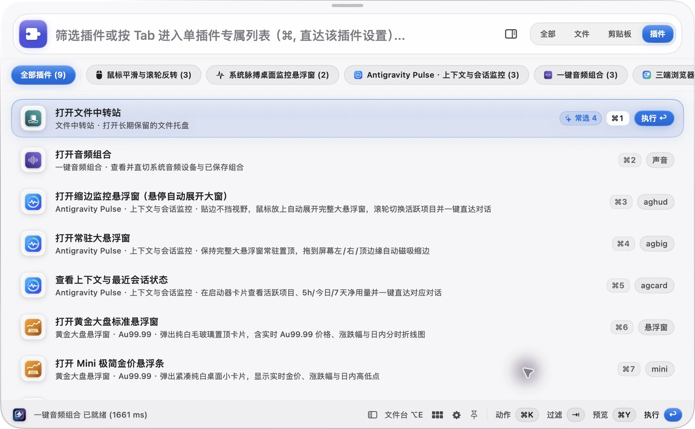

# Lucent 官方插件商店与扩展示例 (`plugin-demo`)

本目录既是仓库自带的**完整自定义插件商店示例（含 `lucent-registry.json`、`dist/*.zip` 校验归档包与 `starters/*.zip` 内置起始模板包）**，也是面向 **Lucent Plugin v3.7** 架构的 **100% 原生 Swift 6（零外部依赖、零 Python 运行时依赖）** 独立 SwiftPM 工程：

- **统一原生底座 (`Package.swift` + `Shared/PluginKit/`)**：封装 `stdin` JSON 与配置解析、结构化 `ViewPayload` 编码、`PluginData` 免前缀索引 (`search-index.json`) 与运行摘要 (`status.json`) 原子写盘、原生 Unix Domain Socket (`Darwin.socket`) Host Bridge 客户端以及带超时强杀的子进程与同步 HTTP 工具；全部插件均预编译为签名裁剪后的 `arm64` Mach-O 可执行文件（`bin/<id>`），在新装 macOS 上无需安装 Python 3 或 Xcode Command Line Tools 即可毫秒级启动。
- [`file-shelf/`](file-shelf/README.md)：**文件中转站**（跨重启保存文件引用，支持托盘拖入、Everything 和工作台上下文，原生多选拖出）。
- [`audio-presets/`](audio-presets/README.md)：**一键音频组合**（保存输入和输出，按组合名搜索或用热键切换，经宿主回读实际设备）。
- [`antigravity-pulse/`](antigravity-pulse/README.md)：**Antigravity Pulse · 用量统计与额度监控**（零侵入只读双层增量索引本地 `transcript.jsonl`，提供缩边悬停展开悬浮窗 + 独立可缩放全景统计大窗双窗协同，支持 52 周 GitHub 风格自适应每日 Token 贡献热力图与日期下钻、多维趋势与 24 小时编码节律、模型/项目排行、USD/CNY 切换、一键生成 `@2x` Retina 精美分享海报并复制剪贴板，以及官方 `agy statusLine` 共享/本机独享实时额度监控）。
- [`browser-hub/`](browser-hub/README.md)：**三端浏览器书签与历史中枢**（原生 `SQLite3` WAL 无锁快照与 `PropertyListSerialization` 直连 Microsoft Edge、Google Chrome 多 Profile 与 Apple Safari 书签、阅读列表及历史记录，自动同步 `⌥Space` 免前缀索引并支持按来源浏览器打开）。
- [`gold-monitor/`](gold-monitor/README.md)：**黄金大盘悬浮窗 · Au99.99**（实时监控上海金 `Au99.99` / `Au(T+D)` 人民币元/克行情，支持标准分时图卡片、Mini 悬浮条与贴边极简挂件丝滑原地变形及滞回防抖价格预警）。
- [`local-send/`](local-send/README.md)：**LocalSend 局域网快传**（零常驻窗口绑定会话实现完整 LocalSend Protocol v2.1：开窗启动 UDP 组播发现与自签名 HTTPS 收发、关窗立即销毁进程释放 `53317` 端口，支持 Finder/中转站文件拖入与流式大文件传输，并经 `contextRouter` 与 `file-shelf`、`translate-hub`、`notion-bookmarks`、`quick-remind`、`lumalink-companion` 双向联动）。
- [`lumalink-companion/`](lumalink-companion/README.md)：**流光随行 · LumaLink 远控伴侣**（纯外部沙盒 `resourceScopes: []` + 受控宿主桥接 `capabilities: ["lumaLinkStatus"]` 全功能远控台，支持置顶配对二维码、多屏 HiDPI 切换、防窥黑屏、防休眠与设备解绑）。
- [`notion-bookmarks/`](notion-bookmarks/README.md)：**Notion 书签收藏插件**（云端 REST API + 本地免前缀检索索引示例，声明 `capabilities: ["clipboard"]`、`resourceScopes: ["network", "filesystem"]`）。
- [`translate-hub/`](translate-hub/README.md)：**流光译站 · 划词/截图多源翻译与生词本**（联动 `selection`、`ocr`、`audio`、`clipboard` 桥接，支持跨应用划词即译、截图离线识字翻译、免配置词典与本地 Ollama 并行、原声朗读及导出 Anki `.tsv` / `.csv` 生词卡片）。
- [`mac-pilot/`](mac-pilot/README.md)：**桌面中控台 · 系统控制、设置直达与访达助手**（支持音量档位/静音切换、防休眠常亮、16 项 macOS 系统设置分栏免前缀秒达、访达当前目录防重名新建文件与外置磁盘一键安全推出）。
- [`quick-remind/`](quick-remind/README.md)：**闪电提醒 · 一句话倒计时与提醒看板**（解析 `10m 喝水`、`18:30 拿快递`、`明天 9:00 周报 工作日` 等自然短语，零常驻守护同步 macOS 原生提醒事项准点弹窗，支持推迟 Snooze 与语音播报）。
- [`screen-shield/`](screen-shield/README.md)：**状态屏 · 清洁屏幕与暂离防误触遮罩**（一键盖住全部显示器展示「清洁屏幕」「请勿触碰」「马上回来」或自定义告示，联动拦截键盘与滚轮误触，长按 `Esc` 2 秒安全退出）。
- [`window-snap/`](window-snap/README.md)：**窗口分屏与工作区**（纯原生液态玻璃不抢焦点悬浮控制台 + 22 项静默全局热键命令，支持半屏/三分屏/四象限/黄金居中/跨屏瞬移/一键撤销与多屏工作区布局快照秒恢复，零后台常驻）。
- `Starters/`（`sys-ip-dns` / `port-killer` / `shell-note`）：内置精选模板画廊（`PluginStarterGallery`）的三款原生 Swift 源码与预编译产物源。



## 快速使用

### 方式一：作为插件商店一键入驻（推荐）

1. 打开 **Lucent → 设置 → 插件中心 → 精选市场**。
2. 在顶部「**智能入驻 / 直装地址**」输入框粘贴本目录的本地路径（如 `/path/to/Lucent/plugin-demo`）或远端仓库的 `/tree/main/plugin-demo` 子目录地址，点击 **「识别」**。
3. 自动入驻 **「Lucent 官方示例商店 (plugin-demo)」** 后，即可在商店列表中带 `SHA-256` 校验一键安装任意官方插件。

### 方式二：命令行编译并安装到本地插件目录

```bash
# 编译原生 arm64 Swift 二进制并安装全部商店插件
bash plugin-demo/install.sh

# 或单独安装指定插件（如 antigravity-pulse / gold-monitor / translate-hub / browser-hub）
bash plugin-demo/install.sh translate-hub
```

### 方式三：重新编译签名并打包商店归档与 `lucent-registry.json`

修改 `Shared/PluginKit/`、各插件 `Sources/` 或 `Starters/` 源码后，执行以下命令即可统一编译 `arm64` Release 二进制、执行 `strip -x` 与代码签名、打包 `starters/*.zip`，并调用 `lucent-mcp` 完成 v3 校验、生成 `dist/*.zip` 及更新 `lucent-registry.json` 中的 64 位 `SHA-256`：

```bash
bash plugin-demo/package-store.sh
```
