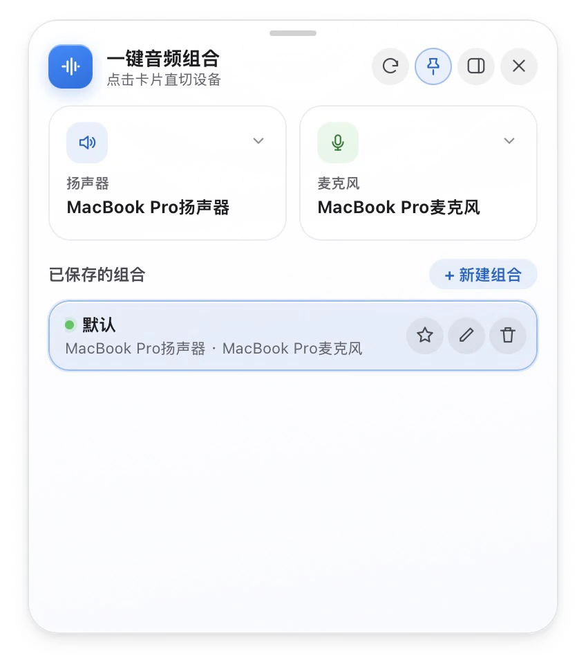

# 一键音频组合 · Audio Presets

从 `⌥Space` 搜索「打开音频组合」，允许访问默认音频设备。无边框液态玻璃悬浮控制台同时支持**单点直切扬声器/麦克风**与**组合一键切换**。

- **点击设备卡直切**：直接点顶部「扬声器」或「麦克风」卡片即可下拉单切当前默认设备，无需先建组合。
- **组合切换与热键直达**：保存常用输入/输出组合后，可直接从 Lucent `⌥Space` 搜索组合名切换，或给「切到常用音频组合」绑定独立全局热键，切换成功弹出液态玻璃 HUD 反馈。
- **轻量化悬浮与贴边**：支持双主题（凝霜留白 / 霓彩流光）同步、窗口置顶开关、拖至屏幕边缘自动贴靠或收起为紧凑悬浮胶囊，按 `Esc` 即用即关。
- **实测回读与异常回滚**：切换后由 Core Audio 实测回读默认设备，蓝牙抢占或部分失败时自动尝试恢复原设备并诚实提示状态。

需要 Lucent 0.9.9.2 或更新版本。插件数据保存在本机，关闭窗口即释放 Web 进程，无后台常驻消耗。

Open **Audio Presets** from Lucent search and grant audio device access. Switch speakers or microphones directly from the top cards, save presets for instant `⌥Space` switching, or dock the Liquid Glass floating console as a compact edge pill.
