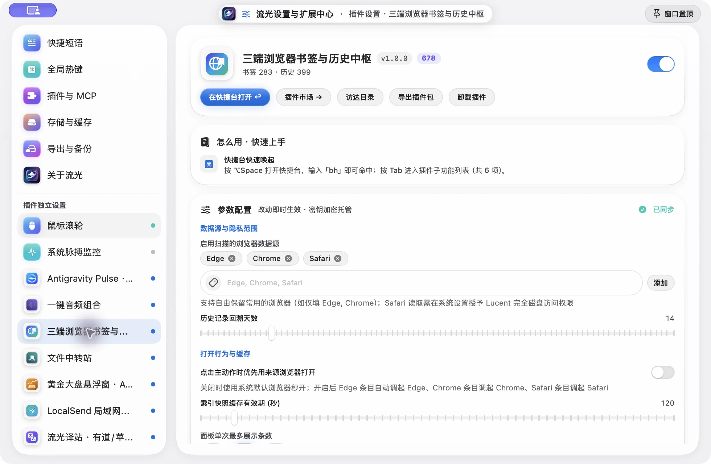

# 三端浏览器书签与历史中枢 (`browser-hub`)

基于 **原生 Swift 6 (`PluginKit` + `SQLite3` + `PropertyListSerialization`)** 编译为 `arm64` 可执行文件（`bin/browser-hub`，零 Python 运行时依赖）。无需安装任何浏览器扩展或登录云账号，直接在本机安全直连 **Microsoft Edge**、**Google Chrome**（自动识别 `Default` 与全部 `Profile *` 多配置档昵称）以及 **Apple Safari** 的书签、Reading List 阅读列表与近期历史记录，并自动将高频词条同步至 Lucent 的 `⌥Space` 零延迟免前缀检索索引（`search-index.json`）。

## 核心特性

- **无锁 WAL 快照读取（浏览器运行中零阻塞）**：查询 `History` / `History.db` 前自动将 SQLite 主文件及 `-wal` / `-shm` 拷入隔离临时目录并以 `PRAGMA query_only = ON` 只读打开，既不会锁死正在运行的浏览器，也不会遇到 `database is locked` 报错。
- **跨端智能去重与双速检索**：
  - **0ms 免前缀直搜**：每 5 分钟（或手动执行 `bhsync`）将书签与高频历史导出至 `PluginData/browser-hub/search-index.json`，在 `⌥Space` 直接输入网页标题、全拼/首字母或域名即可秒开；
  - **实时复合过滤语法**：进入插件视图后支持 `@edge`、`@chrome`、`@safari` 限定浏览器，`@bm`（仅书签）、`@his`（仅历史）限定类型，以及 `#文件夹名` 过滤收藏夹目录。
- **支持用来源浏览器打开与本地星标置顶**：每条结果均提供 **「用 Edge / Chrome / Safari 打开」** 动作按钮（调用 `open -b` 精准唤起原浏览器），也可在插件设置开启「默认用来源浏览器打开」；支持在 Lucent 内独立星标置顶常用网页而不改动浏览器原始文件。
- **Safari 隐私权限友好降级**：macOS 对 `~/Library/Safari` 默认受 TCC 保护；未授予「完全磁盘访问权限」时，Edge 与 Chrome 依然正常直连可用，同时卡片内提供一键跳转系统隐私设置的引导项。

## 安装方式

1. **通过插件市场订阅 `plugin-demo` 商店一键安装**：打开 **Lucent → 设置 → 插件中心 → 精选市场**，在顶部地址栏粘贴本仓库下的 `plugin-demo` 目录路径，在商店列表中点击 `三端浏览器书签与历史中枢` 右侧的 **「一键安装」**。
2. **命令行快捷安装**：`bash plugin-demo/install.sh browser-hub`
