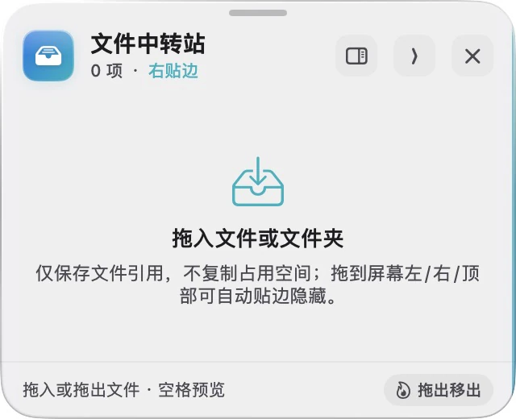

# 文件中转站 · File Shelf

从 `⌥Space` 搜索「打开文件中转站」。把 Finder 里的文件和文件夹拖进托盘，或在 Everything、文件工作台的右键菜单中选择「放入文件中转站」。切到网页、邮件或聊天，再从托盘拖出。

- **靠边自动贴边隐藏**：拖到屏幕左/右边缘即可磁吸贴边并自动收起为液态玻璃拉环；鼠标悬停或拖文件靠近即自动滑出展开，也可点击顶部图钉固定常驻。
- **高频文件操作**：支持多选、筛选（`⌘F`）、空格快速查看、双击打开、复制文件（`⌘C`）、右键菜单（访达定位/复制路径/移出）与可选「拖出移出」模式。
- **跨重启持续保留**：文件引用与打开状态均跨重启自动恢复；移出或清空只删除中转站条目，原文件完好留在磁盘上。
- **智能身份追踪**：源文件移动、改名、删除或外置盘断开后自动识别状态，支持一键「重新定位」。

需要 Lucent 0.9.9.2 或更新版本。权限为「文件中转站」，由宿主提供原生液态玻璃浮窗、安全书签解析与本机持久化。

Open **File Shelf** from Lucent search. Drag files or folders in, dock the shelf flush to the left or right screen edge with hover/drop auto-reveal, optionally pop items after dragging out, and resume seamlessly across restarts.
