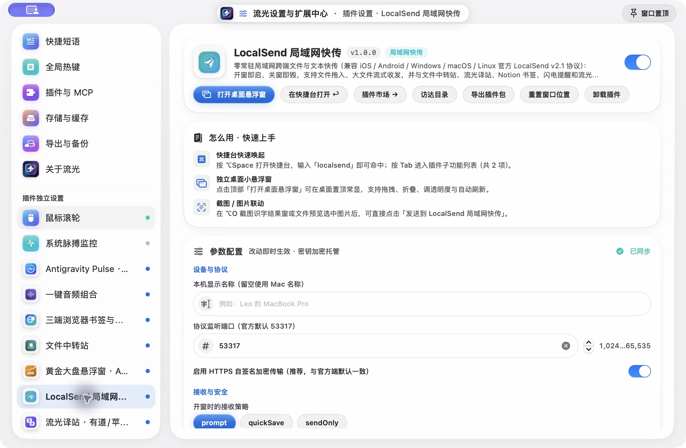

# LocalSend 局域网快传 (`local-send`)

基于 **Lucent Plugin v3.7 窗口绑定会话 (`lucent.session`)** 打造的零常驻 macOS 局域网快传插件，完整兼容 **LocalSend Protocol v2.1**（可与 iOS / Android / Windows / macOS / Linux 官方 LocalSend 客户端直接互通）。

## 核心特性

- **零常驻、即关即毁**：仅在打开快传浮窗（含贴边迷你胶囊）时启动沙箱子进程与 `53317` 监听；关闭浮窗瞬间释放端口、Socket 与内存，不与原版 LocalSend 冲突。
- **完整协议兼容**：支持 UDP 组播 `224.0.0.167:53317` 自动发现、`/api/localsend/v2/register` 双向注册、子网深度扫描与收藏 IP 直连；原生 `CryptoKit` 自签名 X.509 证书 + SHA-256 指纹校验（默认 HTTPS，支持 HTTP 降级）；流式大文件/多级文件夹上传下载、纯文本/链接消息及 PIN 码防爆破。
- **全插件生态双向联动**：
  - **出站**：从 Finder / 文件工作台 / `file-shelf` 直接拖入文件，或从 `⌥Space`、剪贴板、钉图、OCR 结果窗、GIF/MP4 录屏 HUD、`file-shelf` 右键/底栏一键发送（已开窗时无缝复用并追加队列）；
  - **入站**：接收完成卡片经宿主 `contextRouter` 自动匹配已装插件（`file-shelf`、`translate-hub`、`notion-bookmarks`、`quick-remind`、`shell-note` 等）及宿主钉屏/阅读器/剪贴板；支持可选开启「收到文件自动放入文件中转站」「收到纯文本自动写剪贴板」；
  - **LumaLink 协同**：若授予只读 `lumaLinkStatus`，自动置顶高亮已配对的流光随行手机。
